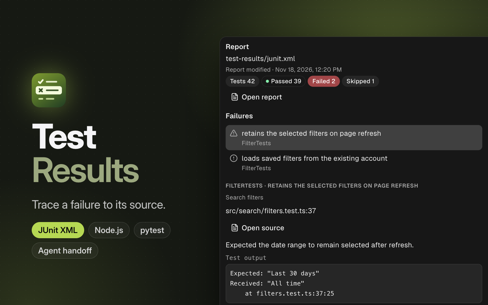
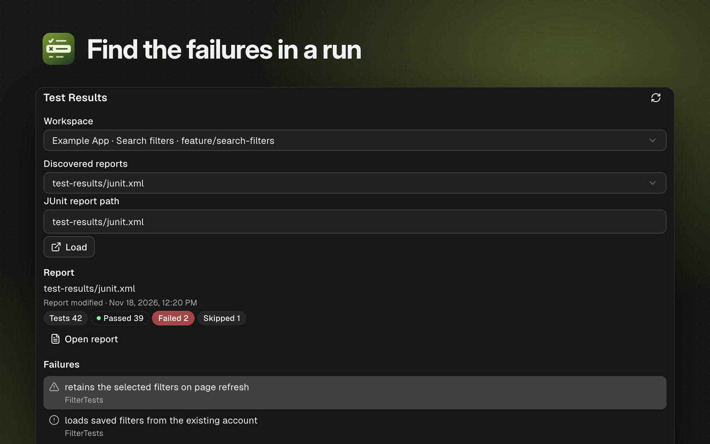
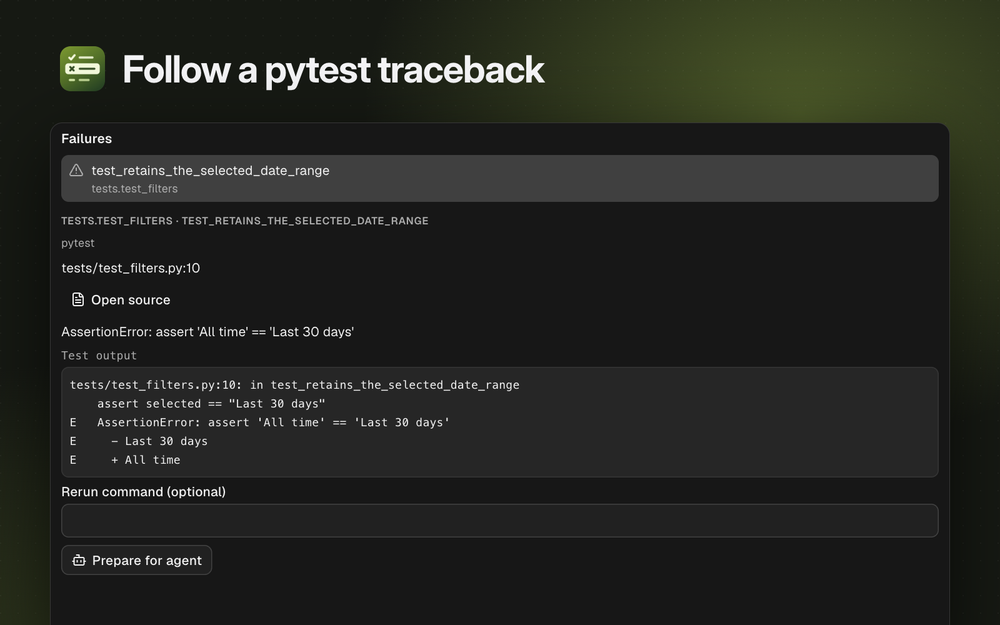
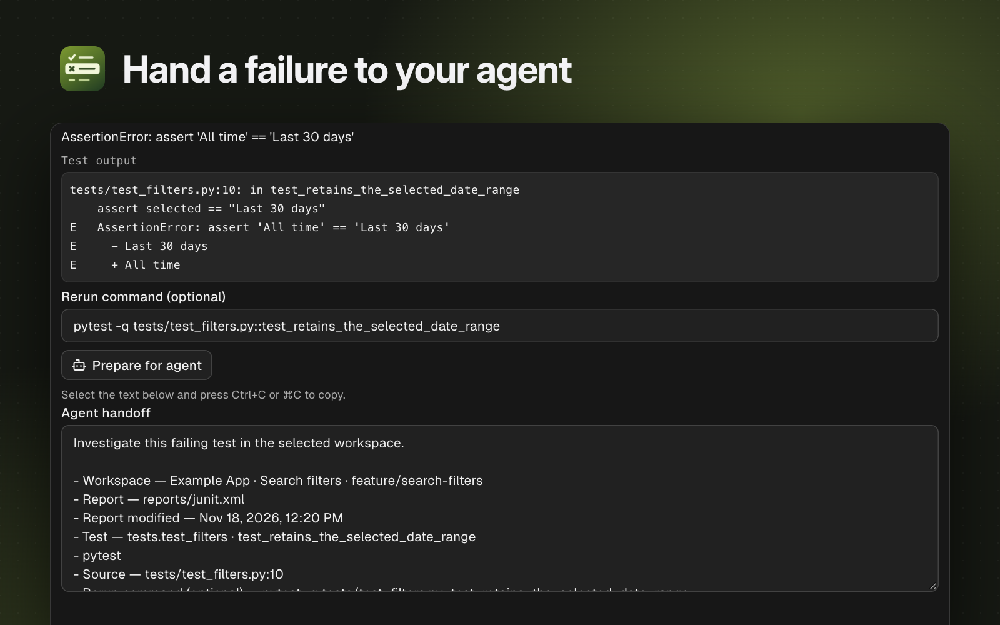
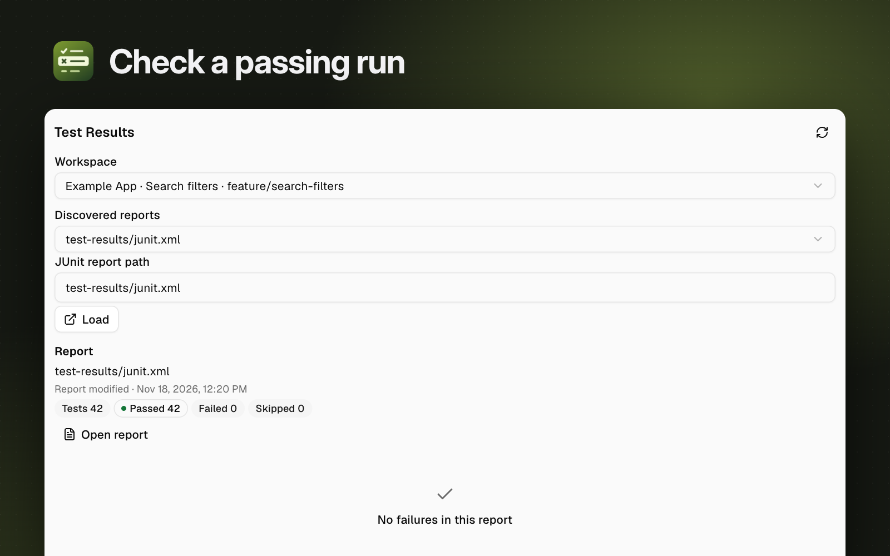

#  Test Results for Orca



Review local JUnit XML reports in Orca's sidebar. Select a failed test to read its assertion and output, open the source file, or prepare a short, editable handoff for a coding agent.

## Install

```sh
orca plugin install Sergei-Popov/orca-test-results@v0.1.0
```

Orca shows the permissions and an approval fingerprint. Review the requested access, then repeat the command with the printed `--approve` flag. Open **Test Results** from the right sidebar.

## Review a test run

1. Choose a local workspace. Test Results opens the newest report it discovers. Select another under **Discovered reports**, or enter a workspace-relative XML path and press **Load**.
2. Check the totals, report path, and modification time. Select a failure to see its assertion, captured output and source location. **Open source** opens the file in an editor tab. The panel displays the line when available. **Open report** opens the original XML.
3. Enter a rerun command if you have one. **Prepare for agent** collects the workspace, report, test name, location and output in an editable text field. Select and copy the draft when you want to share it. The command stays in the draft for you or the agent to run.

To generate reports with Node's built-in test runner and pytest, run either example from your project root.

```sh
mkdir -p test-results
node --test --test-reporter=junit --test-reporter-destination=test-results/junit.xml
```

```sh
python -m pytest --junitxml=reports/junit.xml
```

The Node reporter can place test cases directly under `<testsuites>`. Pytest's default xunit2 format often records the source only in the traceback. Test Results reads both layouts and offers **Open source** for files it can resolve inside the workspace.

## Screenshots

| Report overview | Pytest traceback |
| --- | --- |
|  |  |
| **Agent handoff** | **Passing run** |
|  |  |

## Reports and access

The worker recognizes common JUnit paths in a workspace, including `junit.xml`, `test-results/junit.xml`, `reports/junit.xml`, Maven Surefire and Failsafe reports, Gradle's `build/test-results/test/TEST-*.xml`, and `target/nextest/default/junit.xml`. Discovery lists up to 80 reports, newest first. Use **Refresh** after another test run.

The worker reads UTF-8 XML up to 8 MiB. Totals count individual test cases, including those beyond the first 100 failures shown in the panel. Each failure keeps up to 4,000 characters of test output. The original report retains the complete output.

Orca runs the plugin as a trusted local Node.js worker. It uses `workspace:read` to find local workspaces and `workspace:write` to open a selected file with `editor.open`. Reports are read locally. Sharing a draft is a manual copy operation. The panel follows Orca's English or Russian interface language.

## Develop

Orca loads the TypeScript sources directly. From the plugin checkout, run the SDK tests, type check and plugin checks with the following commands.

```sh
orca plugin types . --json
npx -y -p typescript@5.9.3 -p @types/node@22.20.5 -- sh -c '
  types_dir=$(dirname "$(dirname "$(command -v tsc)")")/@types
  tsc -p . --typeRoots "./.orca/types,$types_dir"
'
orca plugin test . --json
orca plugin check . --json
orca plugin validate . --json
orca plugin inspect . --json
```

The SDK suite exercises the JUnit parser, local files, worker handlers and panel actions. Orca's mock host records editor requests. To exercise desktop file opening, load the checkout with `orca plugin dev watch . --check --json` and use **Open source** in a local workspace.

The gallery uses the native panel scenarios in `src/panel.check.ts` and the capture settings in `tools/listing.json`. The hub provides the renderer and cover template. The listing icon is a 256-pixel PNG rendered from the vector artwork. [Icon artwork](images/icon.svg) · [Listing image tools](https://github.com/Sergei-Popov/orca-plugin/tree/main/scripts/lib/listing)

Development follows git-flow. Feature branches merge into `develop`, and a `release/x.y.z` branch merges into both `main` and `develop`. Release commits on `main` carry annotated `vX.Y.Z` tags.

## License

MIT © Sergei Popov. The bundled XML parser and its dependencies carry their own notices. [License](LICENSE) · [Third-party notices](vendor/NOTICE.md)
